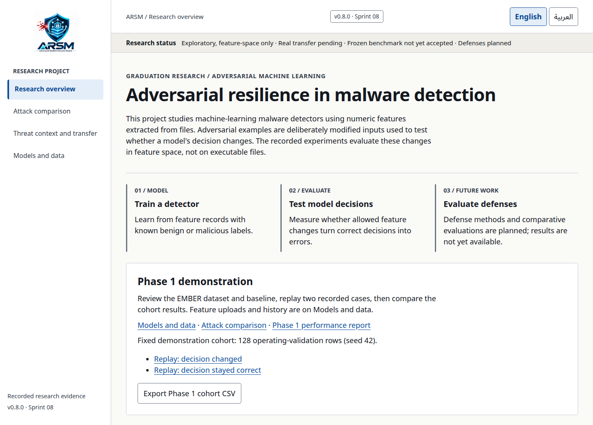
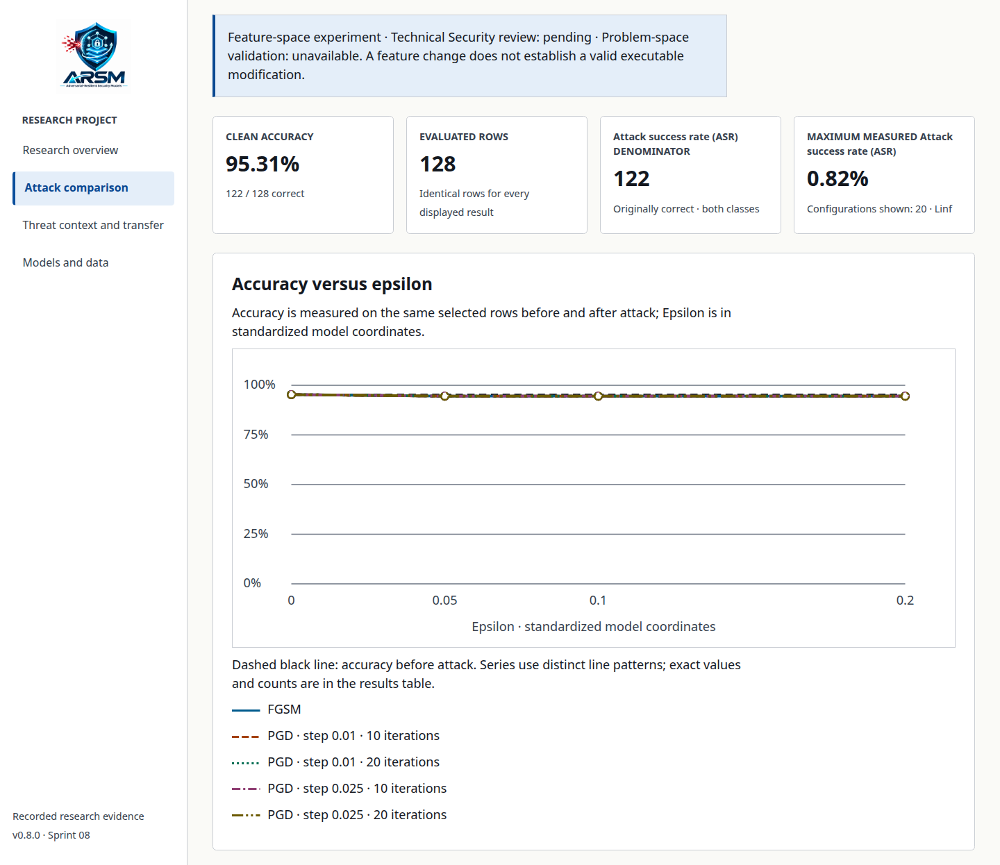

# Adversarial-Resilient Security Models

Defensive machine learning research on malware and network-intrusion detection.
It includes preprocessing and baseline training for the public EMBER2018 and
CIC-IDS-2017 feature datasets. Its FastAPI dashboard replays recorded EMBER
experiments in English and Arabic.

[Dashboard preview](#dashboard) · [Documentation](docs/README.md) · [Project status](docs/progress.md)

## Quick start

On Linux with Git, GNU Make, and Python 3.11 or 3.12, run:

```bash
git clone https://github.com/MatsoDev/Adversarial-Resilient.git
cd Adversarial-Resilient
make setup PY=python3.11
make dashboard
```

Use `PY=python3.12` if that is your installed version. Open
<http://localhost:8501/dashboard/> and look for **v0.8.0 · Sprint 08**.
Recorded results are included in the checkout and require no datasets,
model weights, or token. For Windows, Docker, and platform requirements,
see the [development guide](docs/development.md).

## Dashboard





Follow the [Phase 1 walkthrough](docs/sprint8_demo.md) to replay cases and export the cohort CSV.

## Research status

Phase 1 results cover exploratory feature-space experiments. The latest
baseline achieved **92.5778%** operating-validation accuracy, below the
**93%** freeze gate. The official test remains unopened. Live prediction
requires a verified frozen model and a token. Real transfer measurements,
technical Security review, and defense evaluation are pending.
See the [Phase 1 report](docs/sprint8_phase1_report.md).

Run `make check` before contributing. See the [contribution guide](CONTRIBUTING.md)
and [threat model](docs/threat_model_v0.1.md) for the project workflow and scope.
