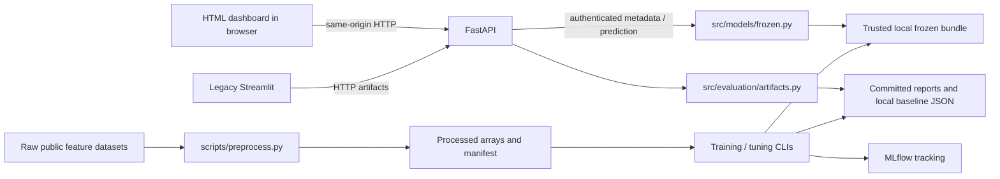

# Architecture overview

Current implementation: Sprint 4 training/tuning and gated feature inference,
plus the Sprint 1 MNIST demo and Sprint 2 data pipeline. Implementation of a
freeze gate is **not** proof of a passing baseline; consult [progress](progress.md)
and the [Sprint 4 report](sprint4_report.md) for measured status.

## Components and boundaries

FastAPI also serves the static HTML/CSS/JS under `dashboard/web/` at
`/dashboard/`; there is no frontend build. The browser does not read local
arrays or checkpoints. Legacy Streamlit runs separately and uses the bounded
`dashboard/client.py` HTTP client.

| Layer | Entry points and responsibilities |
|---|---|
| Shared configuration | `src/config.py`: repository paths, dataset resolution, seed defaults; `src/utils/seed.py`: Python/NumPy/torch seeding |
| Data | `src/data/`: clean-room EMBER v2 vectorization, CICIDS cleaning/deduplication, splitting, atomic output, loaders and manifest verification |
| Models | `src/models/training.py`: classical/MLP validation comparison; `tuning.py`: selection/calibration/test gates; `frozen.py`: verified CPU bundle loading/inference; `tabular.py`: MLP and 1D-CNN |
| Evaluation | `src/evaluation/binary.py`: binary metrics and operating thresholds; `artifacts.py`: bounded, allowlisted research artifact readers |
| HTTP | `api/main.py`: app factory, middleware and static mount; `api/artifacts.py`: read-only routes; `api/prediction.py`: token, body validation and query budget |
| Operator tools | `scripts/setup_environment.py`, `preprocess.py`, `eda_datasets.py`, `train_baselines.py`, `tune_baseline.py`, `art_quickstart.py` |

`src/attacks/` and `src/defenses/` are still placeholders. FGSM/PGD/CW-L2
currently run only in the standalone MNIST demo, not against security detectors.
Public contracts live in the [API README](../api/README.md),
[data module README](../src/data/README.md), [model README](../src/models/README.md)
and [evaluation README](../src/evaluation/README.md).

## Execution and data flows

### Data preparation and reports

1. `scripts/preprocess.py` resolves raw sources in order: CLI, dataset environment
   variable, repo-local `data/raw/<name>`, then `~/Documents/<name>`. Raw files are
   read in place, never downloaded or copied by the pipeline.
2. EMBER preserves the official test partition and makes time-based validation
   from labeled training records. CICIDS cleans/deduplicates before a binary-
   stratified 70/15/15 split. See the [data guide](data/README.md) for details.
3. Processed arrays, metadata, scalers and hashes go under `data/processed/`.
   Full runs in default output directories publish compact manifests under
   `docs/data/manifests/`; subsets/custom outputs do not.
4. `scripts/eda_datasets.py` scans raw sources and optionally enriches its report
   with processed manifests. It generates JSON, figures and the EDA Markdown.

Loaders validate shapes and schema, but do not implicitly re-hash every file.
Training/tuning explicitly verify canonical input filenames and required SHA-256
digests before loading. Hashes detect corruption, not a malicious publisher who
can replace both manifest and data. Do not allow untrusted artifact writers.

### Training, selection and freezing

- **Sprint 3 comparison:** `train_baselines.py` memory-maps inputs, samples rows,
  fits a new raw-feature scaler on selected train rows, and trains Logistic
  Regression, Random Forest, Linear SVM and/or MLP. Validation selects the MLP
  checkpoint; test is never opened. Reports include row hashes, schema/manifest
  identities and subset flags so only compatible runs share a comparison.
- **Sprint 4 selection:** `tune_baseline.py` fits signed-log1p/train-only scaling,
  tries six predeclared MLP/CNN configurations and partitions validation into
  selection/calibration/operating subsets (50/25/25). Selection NLL chooses the
  checkpoint; a separate partition fits temperature and another selects the
  95%-TPR operating threshold.
- Weights/config/scaler/schema are locked before official test evaluation. Only
  a non-subset run with operating-partition accuracy >=93% opens test. Test
  accuracy >=93% permits `status: frozen` / `model_version: baseline_v1`.
  Other outcomes remain blocked candidates. Default prediction uses 0.5, not
  the separately recorded operating threshold. See [the full protocol](sprint4.md).

Both training paths are operator-invoked, synchronous CPU jobs. MLflow defaults
to the local `mlruns/` file store (explicit file-store opt-in); `--tracking-uri`
can select another store and `--no-mlflow` disables logging. The serving API does
not query MLflow. No scheduler, job queue or training-over-HTTP is implemented.

### HTTP request lifecycle

`create_app(store=None, *, baseline_dir=None)` reads Host/docs settings, registers
artifact and prediction routers, and mounts static assets. Tests can inject an
artifact store and bundle directory without changing production paths.

- Host validation rejects unapproved hosts. Middleware adds browser security
  headers, no-store and a restrictive CSP; HTML assets get self-only script/style/
  connection allowances. HSTS is emitted for HTTPS request schemes only.
- Artifact routes map unknown IDs to 404 and known unavailable/invalid artifacts
  to generic 503. The store reads only contained regular files, with per-file and
  aggregate run budgets. `/v1/runs` combines local comparison JSON with the
  committed reference, deduplicates run IDs and excludes invalid batches.
- Prediction first checks the exact bearer token, then charges the socket peer's
  in-memory budget. It streams a bounded JSON body and validates the feature
  contract. Model loading and prediction run in a thread pool; first successful
  loading is locked and cached per router/process. Restart to replace that model.
- `FrozenBaseline` validates the trusted bundle, required hashes, feature order,
  scaler, finite parameters and freeze status, and loads a CPU state dictionary
  with `weights_only=True`. HTTP callers cannot select filesystem paths/models.
- Unhandled exceptions are logged server-side and return generic 500 JSON with
  security headers. Bundle-load exceptions are also logged; clients receive no
  filesystem details. There is no application audit/history persistence.

`/health` is liveness only. It says nothing about artifact availability, model
readiness, data integrity or MLflow. Artifact routes are unauthenticated;
`/v1/baseline` and `/predict` require a local token. This is not multi-user
authorization. Query limits/caches are per process, not distributed; the actual
socket peer is used, not forwarded IP headers.

## Persistence and deployment

There is no application database, ORM, migration system, account store or upload
service. Persistence is files: JSON/Markdown/PNG evidence, NumPy arrays, neural
state dictionaries, local trusted joblib checkpoints and MLflow's file store.
Raw/processed datasets, weights, `.env` and `mlruns/` are ignored. Compact
reference results/manifests/EDA outputs are intentionally committed.

Compose runs **two instances of the same FastAPI application** (`api`: 8000,
`dashboard`: 8501), plus MLflow (5000). Each HTML UI calls its own origin, not
the other instance. Both mount reports and Sprint 4 bundles read-only; each has
independent caches/budgets. `API_URL` retained in Compose is unused by HTML.
The image copies source/docs/assets, installs pinned CPU dependencies and runs
as non-root. API/dashboard drop capabilities and set `no-new-privileges`.
MLflow's official image remains a separate unauthenticated service.

Published ports default to loopback. External exposure needs TLS, external
authentication/authorization and resource controls; neither local tokens nor
security headers establish production readiness. See [development/operations](development.md)
and the dated [security audit](security/SECURITY_AUDIT.md); its Sprint 3 assessment
does not constitute a full Sprint 4 assessment.

## Constraints and extension rules

1. `src/` never imports `api/`, `dashboard/`, `scripts/` or `tests/`.
2. HTTP/UI/CLI layers may import `src/`; API and dashboard communicate by HTTP,
   not mutual Python imports. Serving static UI files does not change this rule.
3. Reusable logic belongs in `src/<concern>/`; runnable orchestration belongs in
   `scripts/`. Tests may import all layers and must write only into temporary dirs.
4. Paths/constants come from `src/config.py`, seeds from `src/utils/seed.py`.
5. Python 3.11–3.12 only; CPU-only torch; no CUDA assumptions. Fixed seeds improve
   repeatability but do not promise bit-identical results across platforms.
6. Preserve test isolation, manifest provenance and the no-test-driven-tuning
   gate. Do not implement planned attacks/defenses as part of unrelated work.
7. Public feature datasets only, no live malware or weaponized tooling.

For a new endpoint, keep transport/auth/validation in `api/`, reusable behavior
in `src/`, and add synthetic HTTP/security tests. Update [the API reference](../api/README.md)
and [configuration reference](configuration.md) if the contract/settings change.
For a UI change edit `dashboard/web/` and run HTML/CSP and Node-backed component
tests; there is no build step. See [testing](testing.md) and
[project structure](project-structure.md) for placement and checks.

CI runs lint/format, coverage, dependency/static security checks, Docker build
and a filtered vulnerability scan; it does not deploy. Non-obvious choices are
recorded in [DECISIONS.md](DECISIONS.md), not inferred from future plans.
